

 

**VITON13** is a private ecosystem with a studio at its core — websites, web apps, 3D and AI.
This is its open code: **24 repositories** you can read, study and run.

[viton13.com](https://viton13.com)  ·  [Portfolio](https://tarasovvitalii.com)  ·  [Instagram](https://instagram.com/viton13company)  ·  [Threads](https://www.threads.net/@viton13company)

 

### Products

<table>
<tr>
<td width="33%"><a href="https://github.com/viton13bussiness-collab/global-control-crm">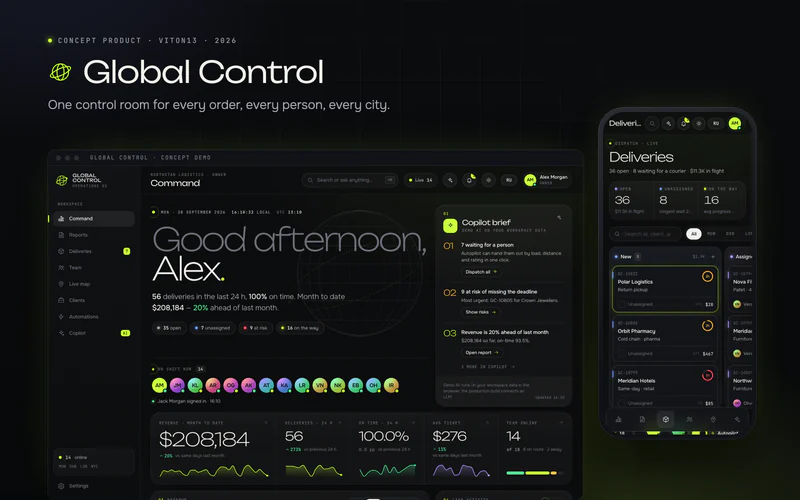</a> <b>Global Control</b> — operations CRM</td>
<td width="33%"><a href="https://github.com/viton13bussiness-collab/hourline-booking">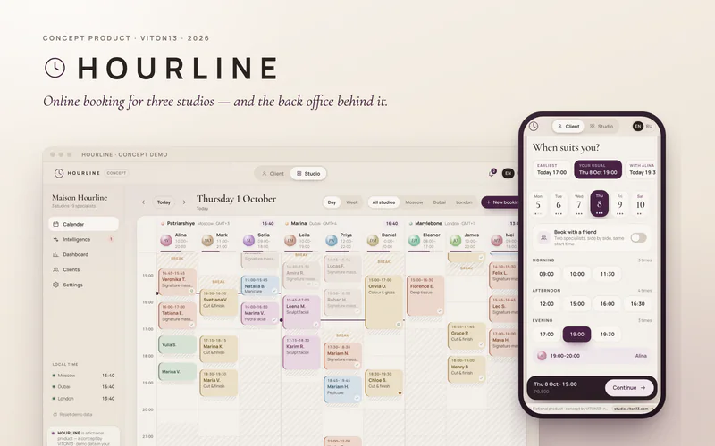</a> <b>Hourline</b> — booking platform</td>
<td width="33%"><a href="https://github.com/viton13bussiness-collab/racklight-3d-warehouse">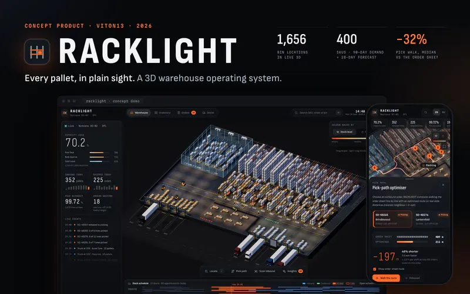</a> <b>Racklight</b> — 3D warehouse system</td>
</tr>
<tr>
<td><a href="https://github.com/viton13bussiness-collab/solvent-cashflow">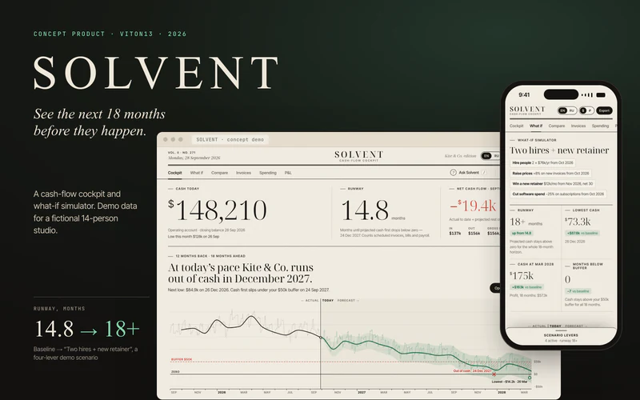</a> <b>Solvent</b> — cash-flow cockpit</td>
<td><a href="https://github.com/viton13bussiness-collab/mobius-school">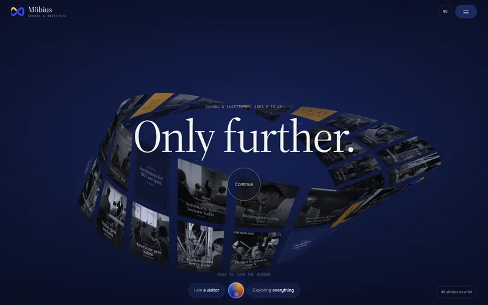</a> <b>Möbius</b> — school &amp; student portal</td>
<td><a href="https://github.com/viton13bussiness-collab/webgl-presentations">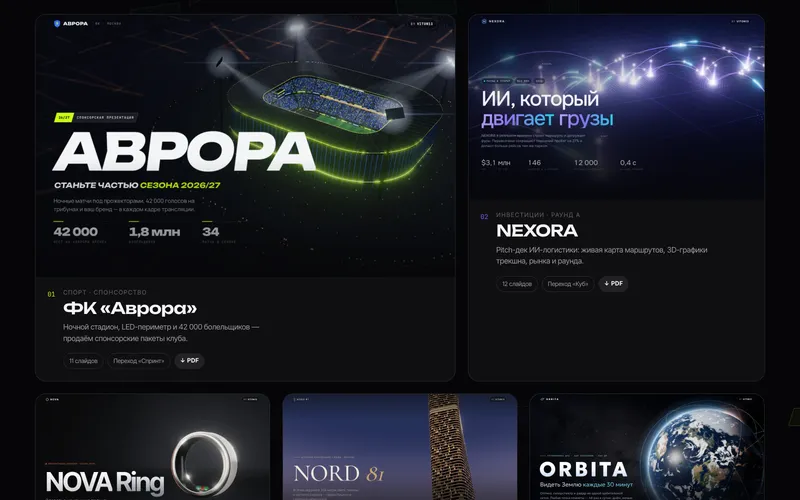</a> <b>3D Presentations</b> — WebGL decks</td>
</tr>
</table>

### Websites

<table>
<tr>
<td width="33%"><a href="https://github.com/viton13bussiness-collab/oriva-audio-store">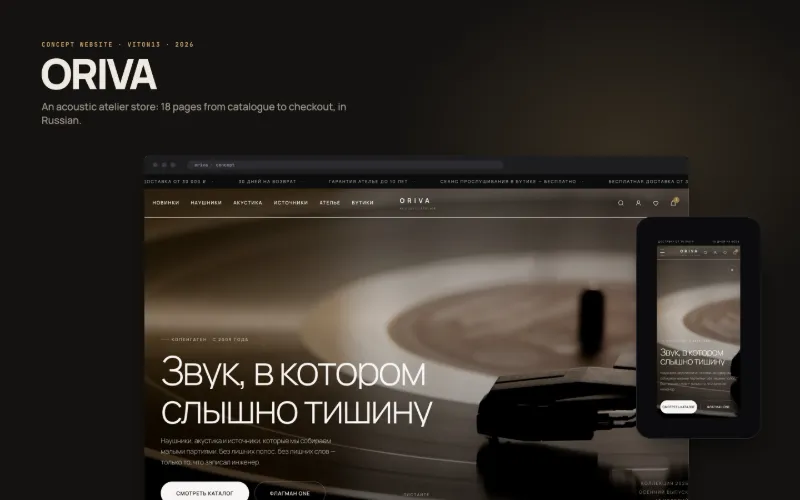</a> <b>Oriva</b> — audio store</td>
<td width="33%"><a href="https://github.com/viton13bussiness-collab/verida-real-estate">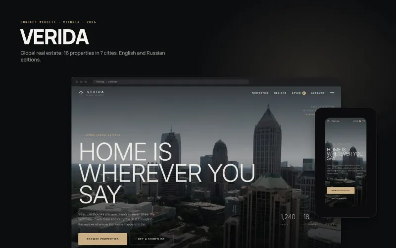</a> <b>Verida</b> — real estate</td>
<td width="33%"><a href="https://github.com/viton13bussiness-collab/vitaliano-restaurant">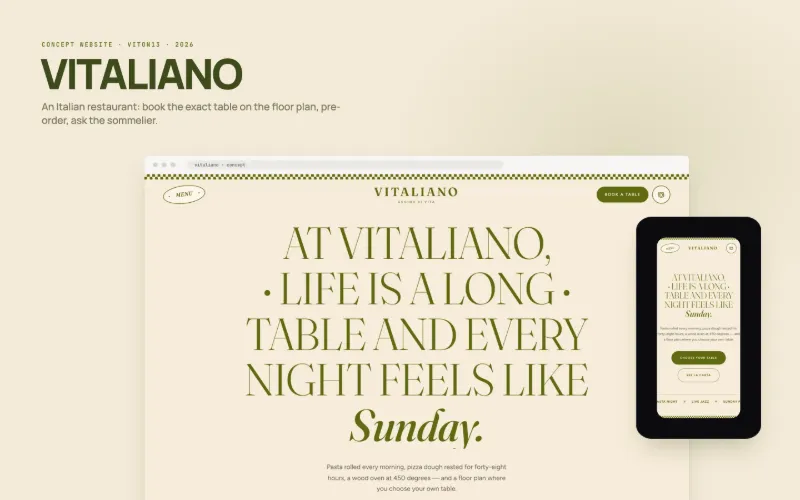</a> <b>Vitaliano</b> — restaurant</td>
</tr>
<tr>
<td><a href="https://github.com/viton13bussiness-collab/stoa-architecture">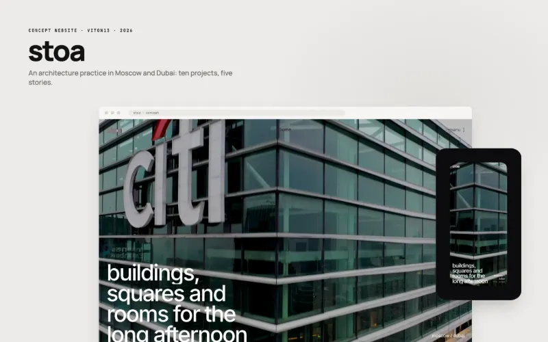</a> <b>Stoa</b> — architecture</td>
<td><a href="https://github.com/viton13bussiness-collab/fifty-design-studio">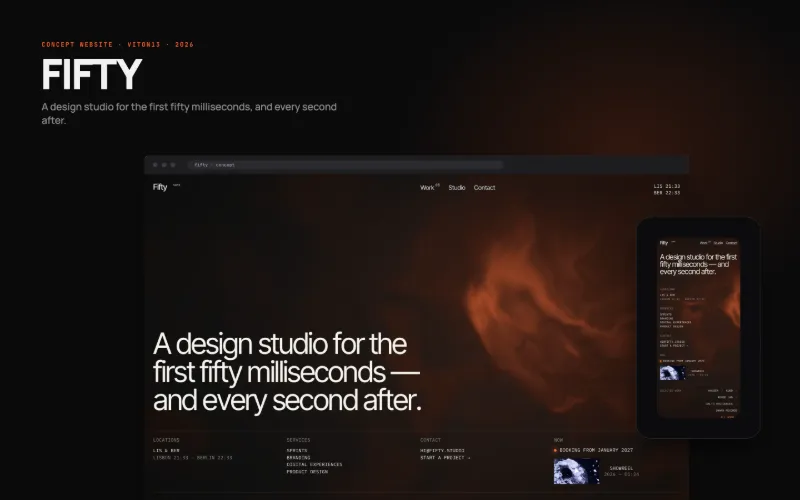</a> <b>Fifty</b> — design studio</td>
<td><a href="https://github.com/viton13bussiness-collab/hypersolid">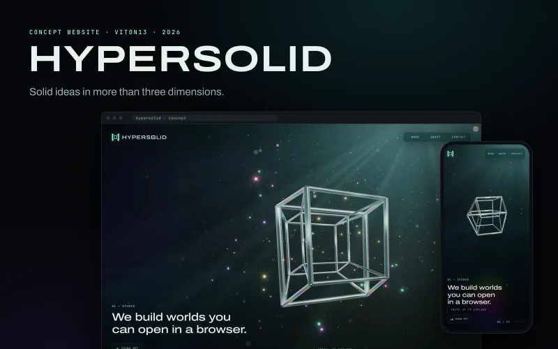</a> <b>Hypersolid</b> — 3D studio site</td>
</tr>
<tr>
<td><a href="https://github.com/viton13bussiness-collab/warmup-show">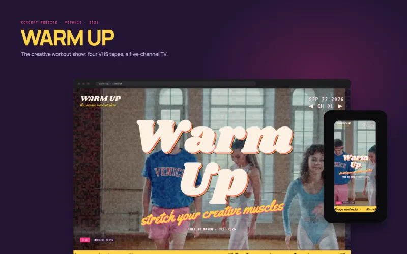</a> <b>Warm Up</b> — creative show</td>
<td><a href="https://github.com/viton13bussiness-collab/viton13-medicine">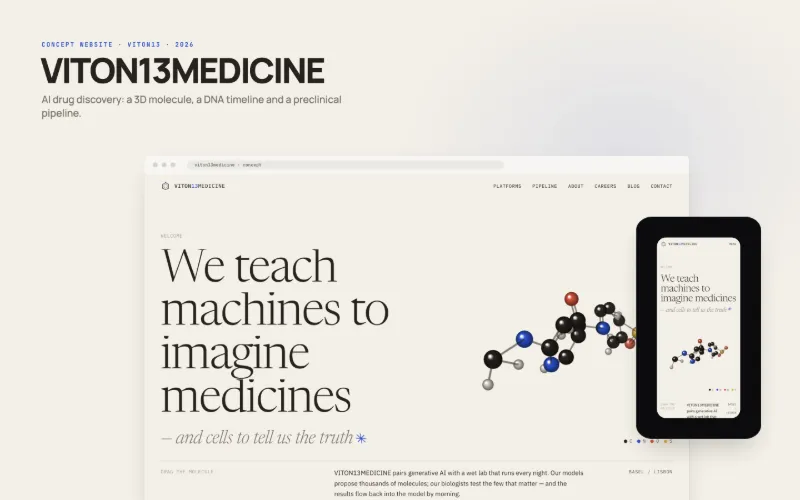</a> <b>Medicine</b> — AI biotech</td>
<td></td>
</tr>
</table>

### 3D

<table>
<tr>
<td>
<a href="https://github.com/viton13bussiness-collab/octopus-on-a-bicycle"><b>Octopus on a Bicycle</b></a> — film in three.js  
<a href="https://github.com/viton13bussiness-collab/find-the-ball-3d"><b>Find the Ball</b></a> — 3D cups game  
<a href="https://github.com/viton13bussiness-collab/blender-backpack-v13"><b>Backpack V13</b></a> — Blender by code
</td>
</tr>
</table>

### Ecosystem &amp; AI

<a href="https://github.com/viton13bussiness-collab/vitapp"><b>VITAPP</b></a> — desktop OS of the ecosystem &nbsp;·&nbsp;
<a href="https://github.com/viton13bussiness-collab/viton-id"><b>VITON ID</b></a> — single sign-on &nbsp;·&nbsp;
<a href="https://github.com/viton13bussiness-collab/ladder-router"><b>ladder-router</b></a> — cost-aware LLM routing &nbsp;·&nbsp;
<a href="https://github.com/viton13bussiness-collab/ai-clinic-receptionist"><b>AI receptionist</b></a> — clinic front desk demo &nbsp;·&nbsp;
<a href="https://github.com/viton13bussiness-collab/american-english-anki"><b>English Anki</b></a> — 8,755 phrases, free

  

---

Source-available, not open source. Free to read, learn from and use in personal, study and non-profit work under <a href="https://polyformproject.org/licenses/noncommercial/1.0.0">PolyForm Noncommercial 1.0.0</a>, unless a repository says otherwise. Commercial use by license — <a href="mailto:info@viton13.com">info@viton13.com</a>. VITON13 and VITO are trademarks.

© 2025–2026 VITON13
